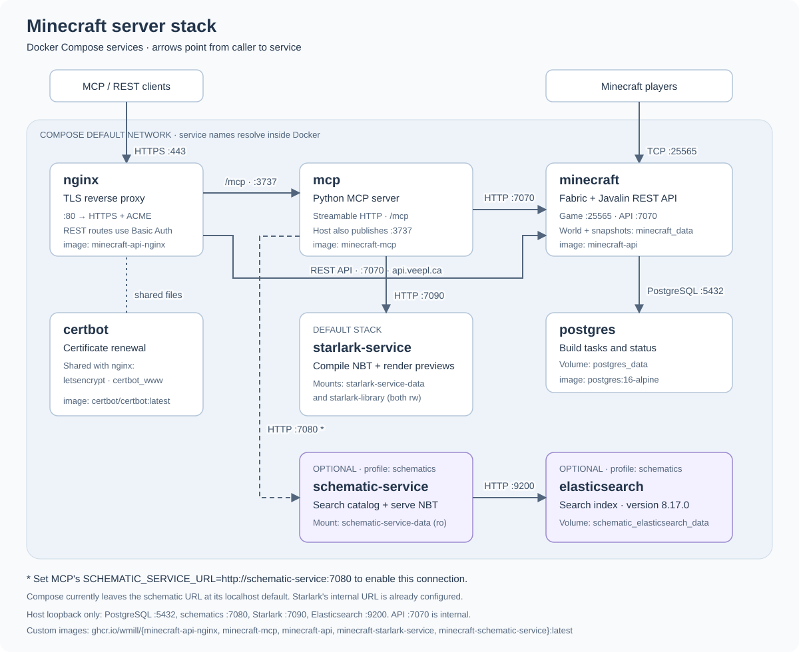

# Minecraft API and MCP

Adds a REST API to Minecraft and implements an MCP server so that you can play around with it in Claude Desktop or other LLMs.

Multiple MCP clients can use [area reservations](docs/area-locks.md) to keep their builds from overlapping. Reserve a cuboid, pass its `lock_id` on writes, and renew during long planning. Abandoned reservations expire after 15 minutes by default.

NBT placements (raw NBT, schematics, Starlark artifacts) can be [dry-run and undone](docs/undo-and-dry-run.md): `dry_run` reports what a placement would overwrite, and `undo_build` restores the blocks saved just before it was placed.

## Docker architecture



The diagram follows [docker-compose.yml](docker-compose.yml) and [nginx.conf](nginx.conf).
The purple services run only when their Compose profiles are enabled. MCP fetches
NBT artifacts from the optional services and sends placements to the Minecraft API.
For the `schematics` profile, also set `SCHEMATIC_SERVICE_URL=http://schematic-service:7080`
in the MCP container's environment; Compose currently configures only the Starlark URL.

# Basics and setup

## Running locally

For local development, run Fabric directly with Gradle and let your MCP client
launch the Python MCP server over stdio. The `certbot`, `nginx`, `minecraft`, and
`mcp` Compose services do not need to be running. You'll need Java 21, uv,
Python 3.12+, and Docker for PostgreSQL.

From the repository root, start the database and Fabric server:

```bash
docker compose up -d postgres
./gradlew runServer
```

`runServer` is the Fabric Loom Gradle task (shown under Fabric in IDE Gradle
panels). On first launch, accept the Minecraft EULA in `run/eula.txt`, then run
the task again. Leave the server running; the REST API is available at
`http://localhost:7070` and Minecraft at `localhost:25565`. The default database
settings match the Compose PostgreSQL service on `localhost:5432`.

Install the MCP dependencies from a second terminal:

```bash
cd mcp
uv sync
```

Configure your MCP client to launch the following stdio server, replacing the
project path with your checkout's absolute path (and using the absolute path to
`uv` if your client requires it):

```json
{
  "mcpServers": {
    "minecraft-api": {
      "command": "uv",
      "args": [
        "run",
        "--directory",
        "/absolute/path/to/minecraft-mcp-api/mcp",
        "minecraft-mcp",
        "--transport",
        "stdio"
      ]
    }
  }
}
```

The equivalent command from `mcp/` is `uv run minecraft-mcp --transport stdio`.
Your MCP client starts and manages this process; no MCP HTTP port is needed.
MCP uses `http://localhost:7070` by default. If you previously changed `BASE_URL`
in `mcp/.env`, point it back to that local API.

Optional services can still run in Docker alongside this setup:

```bash
# Schematic search (see the indexing instructions below)
docker compose --profile schematics up -d elasticsearch schematic-service
# Starlark compilation, previews, and saved scripts
docker compose --profile starlark up -d starlark-service
```

The local MCP defaults already target their published localhost ports, 7080 and
7090. Starlark image builds require the submodules to be initialized first with
`git submodule update --init --recursive`.

There are MCP clients like Claude Desktop or Goose which connect to the LLM and run MCP commands with the server.

Next there is the MCP server, which for this project runs locally from the `mcp` directory.

## MCP Server Config

I'm running everything with uv. You should be able to do a `uv sync` then `uv run minecraft_mcp.py` to start it up.
You can also start it in sse mode with `uv run minecraft_mcp.py --transport sse --port 3001`.

I'm using python `3.13.9`. Some of the dependencies don't support 3.14 yet.

Try `npx @modelcontextprotocol/inspector uv run  minecraft_mcp.py` to make sure it's listing tools. 

The MCP server will aim at localhost:7070 by default.

You can change this with `mcp/.env`, it will check the BASE_URL value, eg `BASE_URL="http://localhost:7070"`

The optional schematic service defaults to `http://localhost:7080`. Override it in `mcp/.env` with:

```bash
SCHEMATIC_SERVICE_URL="http://localhost:7080"
```

The optional Starlark build service defaults to `http://localhost:7090`. Override it in `mcp/.env` with:

```bash
STARLARK_SERVICE_URL="http://localhost:7090"
```

## MCP Client config

There's a sample Claude Desktop Config in `mcp/mcp_config.json`. You'll need to change the paths.

To get it working with goose I needed to set up a script in my $PATH,

```bash
cd /path/to/minecraft-api-mcp/mcp
uv run minecraft_mcp.py
cd -
```

Then tell it to run the script.

Visual Studio Code was able to use the Claude Desktop settings after going through some config options.

## Minecraft Server setup

First you'll need the postgres image up and running `docker compose up -d postgres`

After that the gradle runServer command worked for me. Kudos to the fabric devs.

## Docker builds and x64 deployment

Use `./gradlew dockerCompose` to rebuild and start the local stack. It runs
`shadowJar -> remapJar -> prepareDocker` before `docker compose up -d --build`.
`./gradlew dockerBuild` builds just the local Minecraft image. Local builds use
the host architecture; deployment builds use Bake and default to `linux/amd64`.
The Dockerfile copies only `build/docker/mcpapi.jar`, staged from the current
remapped fat jar, so old jars in `build/libs` cannot enter the image.
On startup, the entrypoint removes legacy `mcpapi-*-fat-remapped.jar` files from
the persistent mods directory before installing the stable `mcpapi.jar`.
The Minecraft image also requires the Fabric launcher/API jars in `mods/`,
`server.properties`, and an accepted `eula.txt`.

For deployment, start Docker and check your builders:

```bash
docker buildx ls
# Only if the multiarch builder does not already exist:
docker buildx create --name multiarch --driver docker-container --use
```

For each build/push session, select and start that builder, then run Gradle:

```bash
docker buildx use multiarch
docker buildx inspect --bootstrap multiarch
docker login ghcr.io  # if not already authenticated
./gradlew dockerPush
```

`dockerPush` prepares the jar and runs `docker buildx bake -f docker-bake.hcl --push`
for Minecraft, MCP, and nginx, tagged under `ghcr.io/wmill` with `latest`.
It pushes directly without loading the finished images into the local image store.
`./gradlew dockerBake` builds the same targets into the builder cache without
pushing. Optional schematic/Starlark services are not in the Bake default group.
The explicit `-f` avoids implicitly merging Compose configuration into Bake.

Overrides and the equivalent manual workflow (run preparation every time):

```bash
REGISTRY=ghcr.io/wmill TAG=release-1 ./gradlew dockerPush
PLATFORMS=linux/amd64,linux/arm64 ./gradlew dockerPush

./gradlew prepareDocker
docker buildx bake -f docker-bake.hcl --push
```

On the x64 server, from its configured Compose directory:

```bash
docker compose pull minecraft mcp nginx
docker compose up -d --no-build minecraft mcp nginx
```

Deleting local application images does not require recreating the builder.
BuildKit also keeps a separate build cache; inspect and trim it when disk space
is tight (pruning makes later builds slower):

```bash
docker system df
docker buildx du --builder multiarch
docker buildx prune --builder multiarch --max-used-space 5gb
```

The prune command prompts before removing cache and keeps the builder available.
See Docker's [container builder documentation](https://docs.docker.com/build/builders/drivers/docker-container/)
and [cache pruning options](https://docs.docker.com/reference/cli/docker/buildx/prune/).

## Postgres dev snapshots

For quick local database snapshots, use the helper scripts against the Docker Compose `postgres` service:

```bash
docker compose up -d postgres
./scripts/pg_dump_snapshot.sh
./scripts/pg_restore_snapshot.sh snapshots/postgres/<snapshot>.dump --yes
```

Snapshots are written under `snapshots/postgres/` by default and are ignored by git. You can pass an explicit dump path to `pg_dump_snapshot.sh` if you want a specific filename.

## Schematic service

There is an optional schematic catalog service in `schematic-service/`. It searches metadata from local schematic analysis and serves converted vanilla NBT files so MCP can place them through the existing `/api/world/structure/place` endpoint.

The local data lives under `schematic-service-data/` and is intentionally ignored by git. Current expected inputs are:

- `schematic-service-data/schematic_catalog_gemma3.json` - primary AI-generated catalog
- `schematic-service-data/Schematics-nbt/{schematic_id}.nbt` - converted vanilla NBT files
- `schematic-service-data/schematic-images/{schematic_id}/meta.json` - image/conversion metadata used for enrichment
- `schematic-service-data/schematic-images/{schematic_id}/*.png` - pre-rendered previews

Keep `schematic-images/` as a real directory inside the data directory so the
whole dataset can be deployed with `rsync -a schematic-service-data/ user@host:/path/to/schematic-service-data/`.
Compose mounts this directory without requiring the image-generation repository.
To replace a legacy `schematic-images` symlink with verified copies, run:

```bash
cd schematic-service
uv run python scripts/copy_schematic_images.py
```

The script copies image directories (including metadata) only for IDs with
matching `Schematics-nbt/*.nbt` files, reports missing images, and leaves the
source files untouched. For a new dataset without a symlink, pass
`--source /path/to/nbt-out`. It refuses to overwrite an existing real image directory.

Start the optional stack with:

```bash
docker compose --profile schematics up -d elasticsearch schematic-service
curl http://localhost:7080/health
curl -X POST http://localhost:7080/index/rebuild
```

The `index/rebuild` call initializes the Elasticsearch index from `schematic_catalog_gemma3.json`. Run it after starting the schematic service for the first time, and run it again whenever the catalog, converted NBT files, or image metadata changes. If Elasticsearch is still starting, wait until `/health` reports it as available and retry the rebuild.

The schematic service is not required for normal Minecraft development. You can still run only Postgres and the Minecraft server; schematic MCP tools will report that the service is unavailable.

For local service development:

```bash
cd schematic-service
uv run uvicorn schematic_service.app:app --host 0.0.0.0 --port 7080
```

Useful endpoints:

- `GET http://localhost:7080/health`
- `POST http://localhost:7080/index/rebuild`
- `GET http://localhost:7080/schematics/search?q=tower&limit=5`
- `GET http://localhost:7080/schematics/tags?limit=20`
- `GET http://localhost:7080/schematics/2`
- `GET http://localhost:7080/schematics/2/nbt`

MCP tools added for this flow:

- `get_schematic_tags`
- `search_schematics`
- `get_schematic`
- `place_schematic`

## Starlark build service

There is an optional Starlark build service in `starlark-service/`. MCP users submit Starlark build scripts; the service compiles them into structure NBT with [starlark-to-nbt](https://github.com/wmill/starlark-to-nbt), returns structured diagnostics on failure (so the LLM can edit and resubmit), caches successful builds by content hash, renders preview images of the result, keeps a shared library of saved scripts, and serves the NBT so MCP can place it through the existing `/api/world/structure/place` endpoint.

Two tools are vendored as **git submodules**: starlark-to-nbt at `starlark-service/starlark-to-nbt` and [nbt-image-gen](https://github.com/wmill/nbt-image-gen) (preview rendering) at `starlark-service/nbt-image-gen`. After cloning this repo, run:

```bash
git submodule update --init
```

Start the service with:

```bash
docker compose --profile starlark up -d starlark-service
curl http://localhost:7090/health
```

Builds run in a killable subprocess with a wall-clock timeout, memory rlimit, and volume/output-size caps. `load()` in submitted scripts is confined to the vendored `lib/` component library and saved library versions (`load("../lib/structural.star", ...)`, `load("../library/<name>/v<N>.star", ...)`). Build failures are HTTP 200 responses with `{"ok": false, "error_kind", "diagnostics", "hint"}`, not errors.

Data lives in two places:

- `starlark-service-data/` — artifact cache (NBT, metadata, rendered previews). Git-ignored and safe to delete: identical source always rebuilds to the same artifact id.
- `starlark-library/` — saved scripts, `<name>/meta.json` plus immutable `v<N>.star` versions. Durable and meant to be committed; never edit or delete a published version (see `starlark-library/README.md`).

For local service development:

```bash
cd starlark-service
uv sync
uv run starlark-service          # or: uv run uvicorn starlark_service.app:app --host 0.0.0.0 --port 7090
uv run pytest                    # service tests
```

Settings come from environment variables or `starlark-service/.env`; see `starlark_service/config.py` and `CLAUDE.md` for the full list (`STARLARK_BUILD_TIMEOUT_S`, `STARLARK_BUILD_MEMORY_MB`, `STARLARK_CACHE_MAX_BYTES`, `STARLARK_LIBRARY_DIR`, `STARLARK_PREVIEW_TIMEOUT_S`, ...). Keep `STARLARK_BUILD_MEMORY_MB` at 1024 or above: the Rust starlark runtime reserves about 1GB up front and every build aborts under a smaller cap.

Useful endpoints:

- `GET http://localhost:7090/health`
- `POST http://localhost:7090/build` — `{"source": "...", "entry": "build", "props": {}, "root_size": [w, h, l]}`
- `GET http://localhost:7090/artifacts/{artifact_id}` and `.../nbt`
- `GET http://localhost:7090/artifacts/{artifact_id}/images/{view}?max_px=...` — `view` is `sheet`, `iso`, `top`, `north`, `south`, `east`, `west`, `floors` (a plan of each detected storey), or `section`; add one of `cut_x`/`cut_y`/`cut_z` for a cutaway (`sheet`, `iso`, `section` only)
- `GET http://localhost:7090/docs/catalog?topic=quickstart` — the script API reference; topics include `quickstart`, `full`, `dsl`, `composition`, `errors`, `components`, `math`, `library`, and one per lib module, or pass `component=Name`
- `GET http://localhost:7090/examples` and `GET http://localhost:7090/examples/{name}`
- `POST http://localhost:7090/library` — save a script by `source` or `artifact_id` (with `name`, `title`, `description`, optional `tags`, `author`, `notes`, `parent`); it is rebuilt first and rejected if it fails
- `GET http://localhost:7090/library/search?q=&tag=&author=&max_x=&max_y=&max_z=&limit=`
- `GET http://localhost:7090/library/{name}` and `GET http://localhost:7090/library/{name}/source?version=`

MCP tools added for this flow:

- `build_starlark_structure` — compile source; success returns an artifact id (with `include_preview`, a small iso render too), failure returns numbered diagnostics to fix and resubmit
- `get_starlark_preview` — preview sheet or single view of a built artifact; `cut_x`/`cut_y`/`cut_z` and `view="floors"` show interiors
- `place_starlark_structure` — place a built artifact (applies the artifact's `y_offset` automatically; supports `dry_run` and undo like other NBT placements)
- `get_starlark_docs`, `list_starlark_examples`, `get_starlark_example`
- `save_starlark_script`, `search_starlark_library`, `get_starlark_script` — the shared script library

## Rail planning debug loop

For a manual end-to-end rail planning regression check, run:

```bash
uv run python skills/minecraft-http-gateway/scripts/rail_debug_e2e.py \
  --start-x 0 --start-y 64 --start-z 0 \
  --end-x 200 --end-y 64 --end-z 200
```

The harness will:
- start `docker compose up -d postgres` unless `--skip-postgres` is passed
- start `./gradlew runServer` unless `--reuse-server` is passed
- wait for `http://localhost:7070/api/test`
- create a build, run `plan-rail`, poll until the planning job completes, then audit the build
- exit non-zero if planning fails or audit reports any errors

It writes diagnostics to `logs/rail-debug/<timestamp>/summary.json` and `server.log`.
